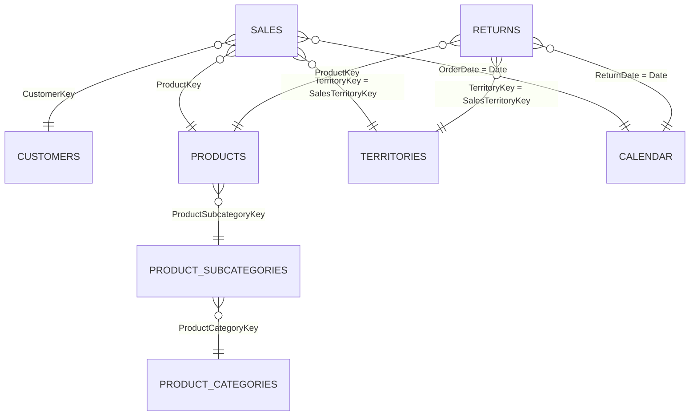

# AdventureWorks Sales Dataset

A clean, relational sales dataset for the fictional bicycle company **Adventure Works Cycles**.
It covers 2½ years of orders (January 2015 to June 2017) across North America, Europe and the Pacific,
and is ready to use for SQL practice, Power BI / Tableau dashboards, Python (pandas) analysis and data-modelling exercises.

All people, emails and companies in this dataset are fictional. AdventureWorks is Microsoft's sample business.

## Files

All files are in the [`data/`](data/) folder.

| File | Rows | Description |
|---|---:|---|
| `AdventureWorks_Sales_2015.csv` | 2,630 | Order lines placed in 2015 |
| `AdventureWorks_Sales_2016.csv` | 23,935 | Order lines placed in 2016 |
| `AdventureWorks_Sales_2017.csv` | 29,481 | Order lines placed January to June 2017 |
| `AdventureWorks_Returns.csv` | 1,809 | Returned products by date and territory |
| `AdventureWorks_Customers.csv` | 18,148 | Customer demographics |
| `AdventureWorks_Products.csv` | 293 | Product catalogue with cost and price |
| `AdventureWorks_Product_Subcategories.csv` | 37 | Product subcategories (e.g. Mountain Bikes) |
| `AdventureWorks_Product_Categories.csv` | 4 | Bikes, Components, Clothing, Accessories |
| `AdventureWorks_Territories.csv` | 10 | Sales regions, countries and continents |
| `AdventureWorks_Calendar.csv` | 912 | One row per day, 1/1/2015 to 6/30/2017 |

## Data model

The tables form a star schema. Sales and Returns are the fact tables. The rest are lookup (dimension) tables.



## Columns

**Sales (2015, 2016, 2017)**
`OrderDate`, `StockDate`, `OrderNumber`, `ProductKey`, `CustomerKey`, `TerritoryKey`, `OrderLineItem`, `OrderQuantity`

**Returns**
`ReturnDate`, `TerritoryKey`, `ProductKey`, `ReturnQuantity`

**Customers**
`CustomerKey`, `Prefix`, `FirstName`, `LastName`, `BirthDate`, `MaritalStatus`, `Gender`, `EmailAddress`, `AnnualIncome`, `TotalChildren`, `EducationLevel`, `Occupation`, `HomeOwner`

**Products**
`ProductKey`, `ProductSubcategoryKey`, `ProductSKU`, `ProductName`, `ModelName`, `ProductDescription`, `ProductColor`, `ProductSize`, `ProductStyle`, `ProductCost`, `ProductPrice`

**Product Subcategories**
`ProductSubcategoryKey`, `SubcategoryName`, `ProductCategoryKey`

**Product Categories**
`ProductCategoryKey`, `CategoryName`

**Territories**
`SalesTerritoryKey`, `Region`, `Country`, `Continent`

**Calendar**
`Date`

## Things to know before you start

- Dates use the US format `M/D/YYYY`, for example `1/18/2015`.
- `AnnualIncome` is stored as text such as `"$90,000 "`. Strip the `$`, commas and spaces before converting it to a number.
- `AdventureWorks_Customers.csv` is encoded as Latin-1 (ISO-8859-1), not UTF-8. Some names contain accented characters.
- Sales has no revenue column. Calculate it as `OrderQuantity × ProductPrice` from the Products table. Profit is `OrderQuantity × (ProductPrice − ProductCost)`.
- The three Sales files have identical columns and can be stacked into one table.

## Quick start

**Python (pandas)**

```python
import pandas as pd

sales = pd.concat(
    pd.read_csv(f"data/AdventureWorks_Sales_{year}.csv", parse_dates=["OrderDate", "StockDate"])
    for year in (2015, 2016, 2017)
)
products  = pd.read_csv("data/AdventureWorks_Products.csv")
customers = pd.read_csv("data/AdventureWorks_Customers.csv", encoding="latin-1")

sales = sales.merge(products[["ProductKey", "ProductPrice", "ProductCost"]], on="ProductKey")
sales["Revenue"] = sales["OrderQuantity"] * sales["ProductPrice"]
print(sales.groupby(sales["OrderDate"].dt.year)["Revenue"].sum())
```

**SQL (DuckDB)**

```sql
SELECT t.Country, SUM(s.OrderQuantity * p.ProductPrice) AS revenue
FROM read_csv_auto('data/AdventureWorks_Sales_*.csv') s
JOIN 'data/AdventureWorks_Products.csv'    p ON s.ProductKey   = p.ProductKey
JOIN 'data/AdventureWorks_Territories.csv' t ON s.TerritoryKey = t.SalesTerritoryKey
GROUP BY t.Country
ORDER BY revenue DESC;
```

**Power BI / Excel**
Import every file from `data/`, append the three Sales tables, and create the relationships shown in the data model above.

## Ideas for analysis

- Revenue, profit and order trends by month, year and region
- Best and worst selling products, subcategories and categories
- Return rate by product and territory
- Customer segmentation by income, occupation, education and age
- Average order value and repeat-customer behaviour

## Source and license

This is a version of the AdventureWorks sample database published by Microsoft for learning and demonstration purposes.
All data is fictional.
